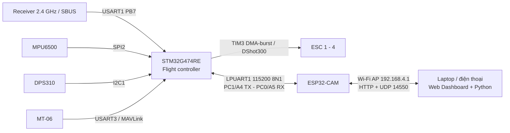

# UAV DATN — STM32G474RE + ESP32-CAM (Direct Wi-Fi)

> **Cập nhật: 04/11/2026 — cấu hình đang sử dụng trên UAV.**  
> Flight controller **NUCLEO-G474RE**, truyền telemetry và PID hai chiều đến **ESP32-CAM AI-Thinker** qua LPUART1 **PC1/PC0 (Arduino A4/A5)**. ESP32-CAM **phát Wi-Fi trực tiếp** `UAV-DIRECT-XXXXXX` tại `192.168.4.1`, không kết nối router. Ground Station nhận UDP tại cổng `14550`.
>
> **Trạng thái: firmware thử nghiệm (flight candidate), không phải hệ thống đã được xác nhận an toàn bay.** Tháo cánh và ngắt nguồn động lực khi nạp, chỉnh PID, OTA hoặc kiểm tra kết nối. Không bật Wi-Fi 2.4 GHz cùng bộ thu RC 2.4 GHz khi bay nếu chưa kiểm tra nhiễu, tầm điều khiển và failsafe.

## 1. Trạng thái hiện tại và phạm vi README

README này mô tả **cấu hình mới nhất đã thống nhất**, dựa trên mã STM32 trong `UAV_DATN5`, bản sửa chân UART **A4/A5 (PC1/PC0)** và firmware **ESP32-CAM Direct-AP Dashboard V2**. Không áp dụng cho các bản cũ dùng ESP8266 hoặc ESP32-CAM kết nối Wi-Fi nhà (`STA`).

| Hạng mục | Trạng thái |
| --- | --- |
| Wi-Fi trực tiếp ESP32-CAM | **Đã kiểm tra thực tế**: laptop kết nối AP, truy cập `192.168.4.1` và ping thành công |
| Telemetry STM32 → ESP32 | **Đã kiểm tra thực tế** sau khi chuyển LPUART1 sang A4/A5: `frames` tăng liên tục, `crc_bad=0` trong log đã cung cấp |
| ESP32 → Ground Station UDP | **Đã nhận gói thực tế** trên Python, nhưng tốc độ không ổn định; có `seq_gaps` |
| Đọc 13 thông số PID qua web | **Đã hiển thị thành công** trong ảnh thử nghiệm gần nhất |
| Áp dụng PID (RAM), lưu Flash | Có code và API; **chưa coi là đã kiểm chứng an toàn vận hành** |
| ESP32 OTA qua Wi-Fi | Có code, kiểm tra SHA-256 và điều kiện an toàn; chỉ dùng sau khi kiểm tra trên bàn |
| STM32 ROM OTA | **Khóa mặc định** trong firmware STM32 |
| Altitude Hold | **Tắt trong bản flight candidate** (`UAV_ENABLE_ALT_HOLD = 0`) |
| Flight/PID/mixer/failsafe | Đang thử nghiệm, **chưa xác nhận đủ điều kiện bay** |

**Lưu ý về phiên bản:** `UAV_DATN5.zip` gốc vẫn chứa cấu hình UART cũ **PA2/PA3**. Để tái tạo đúng cấu hình đang chạy, phải áp dụng bản sửa `stm32g4xx_hal_msp.c` và `UAV_.ioc` chuyển sang **PC1/PC0**. Dashboard V2 là **phiên bản source mới**, không tự xuất hiện trên thiết bị nếu chưa build/nạp/OTA nó.

## 2. Kiến trúc hệ thống



ESP32-CAM là **cầu nối truyền thông**. Nó không trực tiếp điều khiển động cơ, không thay thế các kiểm tra ARM/KILL/failsafe trong STM32. Camera và thẻ microSD **không được sử dụng** trong bản cầu nối này; GPIO13/14 dành cho UART.

## 3. Sơ đồ đấu dây hiện tại

### 3.1. STM32 ↔ ESP32-CAM — đã chuyển chân, KHÔNG dùng PA2/PA3

| NUCLEO-G474RE (Arduino header) | Chân MCU | ESP32-CAM | Tác dụng |
| --- | --- | --- | --- |
| **A4** | **PC1 / LPUART1_TX** | **GPIO13 / UART RX** | STM32 gửi telemetry sang ESP32 |
| **A5** | **PC0 / LPUART1_RX** | **GPIO14 / UART TX** | ESP32 gửi lệnh PID sang STM32 |
| GND | GND | GND | Mass chung |
| Nguồn 5 V ổn định từ nguồn phù hợp | — | 5V của module | Cấp nguồn ESP32-CAM; **không cấp LiPo trực tiếp** |

- UART: **115200 baud, 8 data bits, no parity, 1 stop bit (8N1)**; tín hiệu logic 3,3 V; **TX nối sang RX**.
- Bản sửa sử dụng **AF8 của LPUART1** trên PC1/PC0. Dây đã chuyển từ **D1/D0 sang A4/A5**.
- Với cấu hình A4/A5 này, **không cần tháo/hàn các cầu SB13, SB17, SB18, SB19, SB22, SB23** để đưa PA2/PA3 ra D1/D0.
- Khi kiểm tra điện, tắt nguồn và tháo cánh trước. Không nối nguồn 5 V vào GPIO logic hoặc chân UART 3,3 V.

### 3.2. Các thiết bị ngoại vi STM32

| Thiết bị | Chân STM32 | Giao tiếp / lưu ý |
| --- | --- | --- |
| ESC 1–4 | **PA6, PA7, PB0, PB1** | TIM3 CH1–CH4, DShot300 qua DMA-burst |
| Receiver SBUS | **PB7** | USART1 RX, 100000 baud, 8E2, đảo mức RX |
| MPU6500 | PB13 SCK, PB14 MISO, PB15 MOSI, PB12 CS | SPI2 |
| DPS310 | PB8 SCL, PB9 SDA | I2C1, địa chỉ tùy module 0x76/0x77 |
| MT-06 | **PC11 RX** từ TX cảm biến | USART3, 115200 baud, MAVLink DISTANCE_SENSOR |
| ESP32-CAM | **PC1 TX, PC0 RX** | LPUART1, giao thức telemetry và PID |

Các đường mass tín hiệu phải có điểm GND chung. Nguồn ESC/motor tách khỏi nguồn logic và phải phù hợp phần cứng. Đối chiếu chiều motor và bố trí cánh thực tế trước khi kiểm tra.

### 3.3. Kênh RC trong source

CH1 Roll, CH2 Pitch, CH3 Throttle, CH4 Yaw, **CH5 ARM, CH6 KILL, CH7 Alt-Hold (đang tắt trong code), CH8 CONFIG**. Các ngưỡng và điều kiện ARM/KILL nằm trong `Core/Src/uav_test.c` và cấu hình RC; không thay bằng thao tác từ trình duyệt.

## 4. Cấu trúc source chính

```text
UAV_DATN/
├── README.md                              # Tài liệu này
├── UAV_.ioc                               # CubeMX; LPUART1 đã chuyển PC1/PC0
├── CMakeLists.txt
├── CMakePresets.json
├── STM32G474xx_FLASH.ld                  # Flash 508 KiB; phần còn lại dành cho PID
├── STM32G474RETX_FLASH.ld
├── Core/
│   ├── Inc/
│   │   ├── uav_telemetry.h
│   │   ├── uav_config.h
│   │   ├── flight_pid.h
│   │   └── ...
│   └── Src/
│       ├── main.c                        # Init HAL, UART, TIM, SPI, I2C
│       ├── stm32g4xx_hal_msp.c           # UART PC1/PC0 / AF8 sau patch
│       ├── stm32g4xx_it.c                # IRQ
│       ├── uav_test.c                    # SBUS, IMU, mixer, motor, telemetry
│       ├── uav_telemetry.c               # Gói 88 byte và CRC16
│       ├── uav_config.c                  # Parser + PID GET/APPLY/SAVE
│       ├── flight_pid.c
│       ├── dps310.c
│       ├── mt06.c
│       └── ...
├── Telemetry/
│   ├── ESP32_CAM/
│   │   ├── platformio.ini
│   │   ├── uav_ota4m.csv
│   │   └── src/main.cpp                  # Direct AP + Web Dashboard + UDP + OTA
│   └── GroundStation/
│       ├── uav_ground_station.py         # UDP HELLO + CSV + biểu đồ tùy chọn
│       ├── uav_control.py                # PID/HTTP CLI
│       └── uav_esp32_ota.py              # OTA ESP32 CLI
└── Document/                              # Tài liệu kiểm tra an toàn và lịch sử
```

**Chú ý:** ZIP Dashboard V2 cũng có bản sao `GroundStation/` bên trong `ESP32_CAM/`. Trên máy đang dùng, vị trí chạy thực tế là `Telemetry/GroundStation/`; không cần chạy hai Ground Station đồng thời. Chỉ giữ **một** `src/main.cpp` cho PlatformIO.

## 5. Build/nạp STM32G474RE

### 5.1. Điều kiện bắt buộc trước khi build

Bản firmware STM32 sử dụng **C/STM32 HAL**, có thể mở bằng STM32CubeIDE hoặc build bằng CMake + Ninja + GNU Arm Embedded Toolchain. Trước khi build, **xác nhận đã áp dụng đúng patch PC1/PC0**:

```bash
cd ~/Desktop/UAV_DATN
grep -n 'PC1.*LPUART1_TX\|PC0.*LPUART1_RX\|GPIO_AF8_LPUART1' Core/Src/stm32g4xx_hal_msp.c
grep -n 'PC1.Signal\|PC0.Signal' UAV_.ioc
```

Kết quả cần cho thấy `PC1 = LPUART1_TX`, `PC0 = LPUART1_RX`, `GPIO_AF8_LPUART1`. Nếu vẫn ra PA2/PA3, **chưa được nạp bản đó** với dây đang nối A4/A5. Đảm bảo `UAV_.ioc` và file HAL MSP đồng bộ trước/sau **Generate Code**, vì CubeMX có thể tạo lại cấu hình chân.

### 5.2. Build bằng CMake

```bash
cd ~/Desktop/UAV_DATN
cmake --preset Debug
cmake --build --preset Debug
```

Đầu ra dự kiến theo target CMake: `build/Debug/UAV_.elf`. Dùng **ST-LINK** để nạp và debug STM32 bằng STM32CubeIDE hoặc công cụ tương đương. Không nhầm file ELF của STM32 với `firmware.bin` của ESP32-CAM.

`UAV_CONFIG_ENABLE_ROM_OTA` trong `Core/Inc/uav_config.h` đang bằng **0**. Đường cập nhật STM32 qua ROM không được coi là hỗ trợ ở cấu hình UART PC1/PC0; muốn nạp STM32, dùng ST-LINK.

## 6. Build/nạp ESP32-CAM — Direct Wi-Fi Dashboard V2

Trong `Telemetry/ESP32_CAM/platformio.ini` của Dashboard V2 chỉ có một môi trường **`[env:esp32cam]`**, dùng Arduino framework, bảng phân vùng `uav_ota4m.csv` cho Flash 4 MB. Không dùng môi trường thử nghiệm `esp32cam_ap_test` trong firmware triển khai này.

```bash
cd ~/Desktop/UAV_DATN/Telemetry/ESP32_CAM
~/.platformio/penv/bin/pio run -e esp32cam
```

File ứng dụng tạo tại:

```text
Telemetry/ESP32_CAM/.pio/build/esp32cam/firmware.bin
```

Nếu nạp qua đế ESP32-CAM USB trên bàn:

```bash
ls -l /dev/ttyUSB* /dev/ttyACM* 2>/dev/null
~/.platformio/penv/bin/pio run -e esp32cam -t upload --upload-port /dev/ttyUSB0
```

Thay `/dev/ttyUSB0` bằng **cổng thật** mà Linux phát hiện. Sau nạp, nhấn RST để chạy ở chế độ bình thường, bảo đảm GPIO0 không bị giữ ở mức LOW. Không nạp bản thử `STA` hoặc `esp32cam_ap_test` nếu muốn kết nối trực tiếp.

**Nếu ESP32-CAM đã lắp trên drone**, chỉ cập nhật qua **OTA ESP32** khi trang web báo đủ điều kiện an toàn; không tháo/cắm lại thiết bị chỉ để xem Serial Monitor. Khi OTA bị từ chối, **không tìm cách bỏ khóa an toàn**.

## 7. Kết nối Wi-Fi trực tiếp và Ground Station

ESP32 tự phát:

- **SSID:** `UAV-DIRECT-XXXXXX` (hậu tố theo thiết bị).
- **IP ESP32:** `192.168.4.1`.
- **HTTP Dashboard:** `http://192.168.4.1/`.
- **UDP telemetry:** `192.168.4.1:14550`.
- **Không có Internet** trong mạng này; không cần nhập SSID/mật khẩu router.

Mật khẩu AP và API token được tạo/lưu trong NVS, in ra Serial Monitor lúc khởi động. **Không đưa mật khẩu hoặc API token vào Git, README, ảnh chụp hay log công khai.** Nếu bộ cũ từng bị lộ, cần thay lại thông tin xác thực bằng quy trình bảo trì an toàn.

### 7.1. Linux kết nối vào Wi-Fi UAV

```bash
nmcli device wifi rescan ifname wlp4s0
nmcli -f IN-USE,SSID,SIGNAL device wifi list ifname wlp4s0
nmcli device wifi connect 'UAV-DIRECT-XXXXXX' --ask ifname wlp4s0
ip route get 192.168.4.1
ping -c 4 192.168.4.1
```

Thay `UAV-DIRECT-XXXXXX` bằng SSID thực tế. Lệnh route đúng thường hiển thị `dev wlp4s0 src 192.168.4.x`, **không đi qua gateway router nhà**. Nếu máy báo Wi-Fi không có Internet, giữ kết nối để truy cập ESP32.

### 7.2. Chạy Ground Station Python

```bash
cd ~/Desktop/UAV_DATN/Telemetry/GroundStation
python3 uav_ground_station.py --ip 192.168.4.1
```

Tùy chọn vẽ đồ thị (cần `matplotlib`):

```bash
python3 uav_ground_station.py --ip 192.168.4.1 --plot
```

Ground Station gửi `UAVT_HELLO` định kỳ qua UDP 14550 để ESP32 ghi nhận địa chỉ máy nhận; sau đó ESP32 mới chuyển tiếp gói telemetry hợp lệ. Số liệu ghi vào `uav_telemetry.csv` tại đường dẫn đã in trên Terminal. Chỉ mở một tiến trình nhận UDP 14550 trên cùng máy.

Dòng `packets=...` tăng là có telemetry. `invalid` là gói không hợp lệ theo parser Python; `seq_gaps` cho thấy bỏ lỡ số thứ tự (có thể do STM32 bỏ khung khi UART bận hoặc UDP mất gói). `rate` được chương trình tính từ số gói trên thời gian tích lũy; **không phải tần số tức thời**.

## 8. Web Dashboard và PID

Kết nối laptop/điện thoại vào AP rồi mở `http://192.168.4.1/`. Dashboard V2 có các nhóm **trạng thái kết nối, UART/frames/UDP, quản trị token, cấu hình PID, OTA ESP32**. Trang chủ vẫn tải được trước khi nhập token; API điều khiển/đọc chi tiết yêu cầu header `X-Auth-Token`.

Các thao tác PID:

| Chức năng | API | Ý nghĩa |
| --- | --- | --- |
| **Đọc PID** | `GET /api/pid` | Đọc 13 giá trị hiện hành; **không cần mở khóa chỉnh PID** |
| **Apply RAM** | `POST /api/pid` | Thay giá trị trong RAM STM32; không tự lưu Flash |
| **Save Flash** | `POST /api/save` | Lưu PID vào Flash STM32 nếu điều kiện an toàn và bảo vệ Flash cho phép |

Các trường giao diện theo thứ tự firmware: `angle_kp`, `max_rate_dps`, `roll_kp`, `pitch_kp`, `yaw_kp`, `roll_ki`, `pitch_ki`, `yaw_ki`, `roll_kd`, `pitch_kd`, `yaw_kd`, `integral_limit`, `correction_limit`. Đây là **tham số PID đang thử nghiệm**, không phải bộ giá trị đã tune/đảm bảo bay ổn định.

**Khóa ghi PID:** STM32 chỉ cho phép Apply/Save khi dữ liệu RC hợp lệ và chế độ cấu hình an toàn được kích hoạt (ARM OFF, KILL ON, ga thấp, CH8 CONFIG ON và điều kiện liên quan theo code). Dashboard V2 còn yêu cầu người dùng xác nhận điều kiện kiểm thử trên bàn. Không dùng chức năng này khi motor đang có nguồn động lực.

CLI có sẵn trong `Telemetry/GroundStation/uav_control.py`. Ví dụ đọc trạng thái/đọc PID:

```bash
cd ~/Desktop/UAV_DATN/Telemetry/GroundStation
read -rsp 'API token: ' UAV_API_TOKEN; echo
export UAV_API_TOKEN
python3 uav_control.py --host 192.168.4.1 status
python3 uav_control.py --host 192.168.4.1 get
unset UAV_API_TOKEN
```

### 8.1. Theo dõi UART và UDP qua HTTP

```bash
read -rsp 'API token: ' TOKEN; echo
curl --noproxy '*' --max-time 5 -sS \
  -H "X-Auth-Token: $TOKEN" \
  http://192.168.4.1/api/status | python3 -m json.tool
unset TOKEN
```

Trường `uart_bytes`, `frames`, `crc_bad`, `udp_sent` là **bộ đếm tích lũy từ khi khởi động ESP32**. Tăng `uart_bytes` nhưng không tăng `frames` → cần kiểm tra khung UART/CRC; tăng `frames` nhưng `udp_sent=0` → kiểm tra Ground Station có gửi `UAVT_HELLO` chưa. `/health` là endpoint HTTP không yêu cầu token để kiểm tra dịch vụ sống.

## 9. OTA và các giới hạn quan trọng

### 9.1. OTA ứng dụng ESP32-CAM

Firmware ESP32 có:

- `GET /api/esp32/ota/info`: kiểm tra firmware/version, dung lượng OTA và điều kiện được phép cập nhật.
- `POST /api/esp32/ota`: nhận **`firmware.bin` ESP32** và xác thực kích thước, SHA-256 trước khi ghi/chuyển phân vùng OTA.
- Phân vùng trong `uav_ota4m.csv`: hai slot ứng dụng 1,5 MiB, SPIFFS và vùng dữ liệu phụ trợ cho Flash 4 MB.

**Chỉ cập nhật khi tháo cánh, ngắt nguồn động lực, DISARM + KILL ON + CH8 CONFIG và firmware xác nhận an toàn.** Nếu STM32 đã từng phát frame hợp lệ từ lúc ESP32 boot, điều kiện an toàn phụ thuộc telemetry STM32 mới; không được dùng jumper GPIO2 để bỏ qua. Trường hợp **chưa từng có frame STM32** thì bản firmware có chế độ bảo trì GPIO2 xuống GND ít nhất 3 giây trên bàn, không dùng microSD. Nên kiểm tra trạng thái trước khi chọn file, không tắt nguồn trong lúc cập nhật.

File OTA phải là `.pio/build/esp32cam/firmware.bin` của đúng dự án ESP32-CAM; **không gửi** ELF, STM32 `.bin`, bootloader hoặc bảng phân vùng vào form OTA ứng dụng. Bảng phân vùng tùy chỉnh phải được nạp qua USB ít nhất một lần trước khi dùng app-only OTA.

### 9.2. STM32 ROM OTA

Source vẫn có endpoint thử nghiệm `POST /api/ota` và mã giao tiếp ROM ở ESP32, **nhưng tính năng này khóa mặc định** bởi `UAV_CONFIG_ENABLE_ROM_OTA = 0` trong STM32. Đặc biệt sau khi chuyển LPUART1 sang **PC1/PC0**, không được hiểu rằng STM32 ROM bootloader hỗ trợ đường dây đó. **Dùng ST-LINK để cập nhật STM32.**

### 9.3. Các chức năng chưa hoàn thiện/không nên suy diễn

- `UAV_ENABLE_ALT_HOLD = 0`: MT-06/DPS310 có thể đọc dữ liệu cảm biến, nhưng **không có Alt-Hold vận hành** ở build hiện tại.
- `UAV_EXPERIMENTAL_ARM_ENABLE = 1` và `UAV_BENCH_ARM_LOCK = 0` trong source flight candidate: **ARM có thể được phép** nếu qua các điều kiện của FC. Đây **không phải xác nhận được phép lắp cánh/bay**.
- Telemetry battery/current hiện ghi sentinel `0xFFFF` khi chưa có đường ADC pin/dòng đã kiểm chứng; **không hiển thị như số đo pin thực**.
- Dữ liệu telemetry nhị phân và log ASCII hiện dùng chung **LPUART1**. Code ưu tiên không chặn vòng điều khiển nên có thể **bỏ một số slot telemetry khi UART bận**. `seq_gaps` tăng cần được phân tích; không nên mặc định cho rằng chỉ do Wi-Fi.
- Wi-Fi 2.4 GHz trên ESP32 có nguy cơ ảnh hưởng bộ thu RC 2.4 GHz; cần đánh giá tương thích điện từ và failsafe trước khi bay.

## 10. Khắc phục sự cố nhanh

| Hiện tượng | Nên kiểm tra |
| --- | --- |
| Không thấy `UAV-DIRECT-XXXXXX` | Nguồn 5 V ESP32, firmware đúng `esp32cam`, trạng thái boot/GPIO0, module Wi-Fi |
| Vào được web nhưng Python báo `Network is unreachable` | Laptop có đang nối Wi-Fi ESP32 không? `ip route get 192.168.4.1` phải về mạng 192.168.4.x |
| `/api/status` có `uart_bytes` gần 0, `frames=0` | Nguồn STM32, dây **A4/PC1 → GPIO13**, GND, patch PC1/PC0 đã được nạp |
| `uart_bytes` tăng, `frames=0` | Baud 115200 8N1, phiên bản protocol, CRC, nhiễu UART |
| Telemetry có, nút **Đọc PID** báo `STM32 no reply` | Kiểm tra chiều **GPIO14 → A5/PC0**, ngắt RX STM32, callback và parser lệnh |
| `frames` tăng, `udp_sent=0` | Chưa mở Ground Station hoặc chưa gửi `UAVT_HELLO`; kiểm tra IP/cổng |
| Python có `packets` nhưng `seq_gaps` tăng | Phân biệt mất khung tại STM32/UART với mất gói qua Wi-Fi; UART đang chia sẻ log ASCII |
| Apply/Save PID bị khóa | ARM OFF, KILL ON, ga thấp, CH8 CONFIG, telemetry mới và xác nhận kiểm thử trên bàn |
| OTA ESP32 bị từ chối | Kiểm tra `/api/esp32/ota/info`; không vượt qua khóa an toàn |

## 11. Kiểm thử an toàn trước khi bay

1. Tháo đủ bốn cánh quạt; cố định khung; ngắt nguồn động lực trong các phép đo giao tiếp.
2. Xác nhận mọi dây UART, GND, nguồn ESP32, kết nối RC và cảm biến đúng chuẩn logic.
3. Kiểm tra ARM/KILL, mất liên lạc SBUS, cơ chế failsafe và độ ưu tiên dừng motor bằng bài thử không cánh có kiểm soát.
4. Kiểm tra đúng chiều Roll/Pitch/Yaw, thứ tự motor, mixer và chiều phản ứng điều khiển khi nghiêng khung.
5. Đánh giá ảnh hưởng Wi-Fi 2.4 GHz đến điều khiển RC, bao gồm mất tín hiệu và tầm hoạt động.
6. Chỉ xem xét thử nghiệm nâng cao sau khi có log chứng minh mọi kiểm tra an toàn đạt; firmware này **chưa được chứng nhận bay**.

Tài liệu nội bộ tham khảo: [`Document/FLIGHT_CANDIDATE_VI.md`](Document/FLIGHT_CANDIDATE_VI.md), [`Document/README_KIEM_TRA_AN_TOAN.md`](Document/README_KIEM_TRA_AN_TOAN.md), [`Telemetry/HUONG_DAN.md`](Telemetry/HUONG_DAN.md). **Một số tài liệu cũ vẫn ghi PA2/PA3 hoặc cấu hình STA, hãy ưu tiên README hiện tại cùng source đã nạp thực tế.**

---

**Phạm vi cập nhật tài liệu:** README này chỉ mô tả trạng thái mã nguồn và những phép thử đã báo cáo; nó **không tự thay đổi** `.ioc`, HAL, ESP32 hoặc firmware đang chạy trên drone. Khi đồng bộ một project mới từ `UAV_DATN5.zip`, cần áp dụng patch UART A4/A5 và source Direct-AP Dashboard V2 riêng trước khi build.
