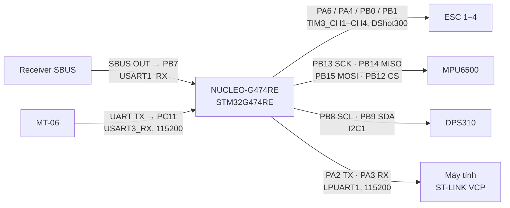

# UAV DATN — STM32G474RE

Firmware thử nghiệm cho board NUCLEO-G474RE. Nhận SBUS, điều khiển bốn ESC
bằng DShot300, đọc IMU MPU6500 và hỗ trợ cảm biến DPS310, MT-06.

> **Cảnh báo:** PID roll/pitch đang bật nhưng chưa được hiệu chuẩn trên UAV
> thực tế. Chưa có PID yaw hoặc giữ độ cao. Đây không phải firmware sẵn sàng
> bay; tháo toàn bộ cánh quạt khi kiểm tra.

## Chức năng

- SBUS qua USART1; bốn kênh TIM3 phát DShot300 đồng bộ bằng DMA-burst.
- MPU6500 qua SPI2: ước lượng góc và PID roll/pitch.
- DPS310 qua I2C1: đọc áp suất, nhiệt độ và độ cao tương đối để ghi log; không
  tham gia điều khiển.
- MT-06 qua USART3: nhận khoảng cách MAVLink; dữ liệu chỉ dùng chẩn đoán.
- Log qua LPUART1.

## Kết nối

| Thiết bị / tín hiệu | Chân MCU | Ghi chú |
| --- | --- | --- |
| ESC 1–4 | PA6, PA4, PB0, PB1 | TIM3_CH1–CH4, DShot300 |
| SBUS RX | PB7 | USART1_RX, 100000 baud, 8E2, đảo mức RX bật |
| MPU6500 | PB13/PB14/PB15, CS PB12 | SPI2, mode 3 |
| DPS310 | PB8/PB9 | I2C1 SCL/SDA; địa chỉ 0x76 hoặc 0x77 |
| MT-06 RX | PC11 | USART3_RX, 115200 baud; cấu hình cảm biến UART/MAVLink |
| UART log | PA2/PA3 | LPUART1, 115200 baud |

### Sơ đồ đấu nối



Nối chung GND giữa NUCLEO, receiver, cảm biến và tín hiệu ESC. Cấp nguồn cho
ESC từ nguồn phù hợp; không cấp nguồn động cơ qua NUCLEO. MT-06 chỉ cần nối
TX của cảm biến vào PC11 để gửi dữ liệu; PC10 (USART3_TX) không được driver
sử dụng. [PINOUT.png](PINOUT.png) tham khảo vị trí chân trên board.

Kiểm tra điện áp, cực tính tín hiệu và sơ đồ chân của board/module thực tế
trước khi đấu nối. I2C cần điện trở kéo lên phù hợp.

Kênh SBUS mặc định: CH1 roll, CH2 pitch, CH3 ga, CH5 ARM, CH6 KILL. CH4 yaw
chưa được điều khiển. Ngưỡng ga và công tắc trong mã là giá trị mặc định, cần
đối chiếu với receiver/transmitter thực tế trước khi thử.

## Trình tự ARM

Firmware chỉ cho ARM sau khi ESC khởi tạo 2,5 giây, SBUS hợp lệ ổn định 1 giây,
ga thấp ổn định 500 ms và IMU khởi tạo/hiệu chuẩn thành công. Đưa CH5 về OFF
rồi bật ON để ARM; CH6 mức cao kích hoạt KILL. Mất link, frame-lost/failsafe,
KILL hoặc lỗi IMU sẽ disarm.

**Thử không cánh quạt:** xác nhận chiều trục IMU, chiều bù PID, thứ tự/chiều
quay motor, công tắc ARM/KILL và tín hiệu DShot bằng thiết bị đo trước khi
xem xét thử nghiệm có cánh.

## Build

Cần CMake, Ninja và GNU Arm Embedded Toolchain (`arm-none-eabi-gcc`):

```sh
cmake --preset Debug
cmake --build --preset Debug
```

Firmware đầu ra: `build/Debug/UAV_.elf`.

## Tài liệu

- [PINOUT.png](PINOUT.png): sơ đồ chân NUCLEO-G474RE.
- [Tài Liệu/README_DShot300.md](<Tài Liệu/README_DShot300.md>): chi tiết DShot và tích hợp.
- [Tài Liệu/TEST_RESULTS.md](<Tài Liệu/TEST_RESULTS.md>): kết quả kiểm tra và giới hạn xác minh.
