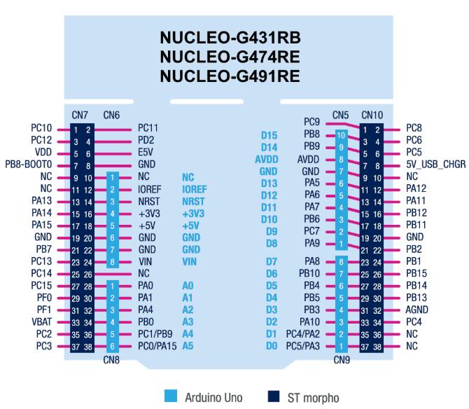

# UAV DATN - STM32G474RE

**Tiếng Việt** | [English](#english)

Firmware cho board STM32 Nucleo-G474RE: nhận tín hiệu từ receiver SBUS, xuất
bốn tín hiệu PWM cho ESC và đọc cảm biến MPU6500 qua SPI.

> **Phạm vi:** Đây hiện là firmware thử nghiệm trên bàn. Cả bốn đầu ra PWM
> nhận cùng một lệnh ga; firmware chưa có bộ điều khiển bay, PID ổn định hay
> thuật toán trộn động cơ. **Không sử dụng firmware này để bay.**

## Sơ đồ chân board

Hình dưới đây thể hiện tên các chân header trên Nucleo-G474RE. Các bảng đấu nối
bên dưới liệt kê những chân được firmware sử dụng.



## Kết nối phần cứng

### Receiver SBUS

SBUS được nhận qua USART1 ở tốc độ 100.000 baud, parity chẵn và hai stop bit.
Firmware bật chức năng đảo mức RX để nhận tín hiệu SBUS đảo cực thông thường.

| Receiver | Nucleo-G474RE | Ghi chú |
| --- | --- | --- |
| Tín hiệu SBUS | PB7 (USART1_RX) | Kiểm tra điện áp và cực tính đầu ra; dùng chuyển mức phù hợp nếu cần. |
| VCC | Nguồn phù hợp với receiver | Tuân theo yêu cầu điện áp của nhà sản xuất. |
| GND | GND | Nối chung mass. |

Ánh xạ kênh trong firmware (kênh SBUS được đánh số từ 1):

| Kênh receiver | Chức năng |
| --- | --- |
| CH3 | Cần ga |
| CH5 | Công tắc Arm |
| CH6 | Công tắc Kill; **mức cao kích hoạt dừng khẩn cấp** |

### Tín hiệu ESC

TIM3 tạo bốn đầu ra PWM thông thường ở tần số 400 Hz. Nối chân tín hiệu của
từng ESC với đầu ra tương ứng. Firmware không quy định vị trí hình học hay
chiều quay động cơ; số đầu ra chỉ dùng để phân biệt các kênh.

| Đầu ra PWM | Chân Nucleo | Kênh timer |
| --- | --- | --- |
| PWM 1 | PA6 | TIM3_CH1 |
| PWM 2 | PA4 | TIM3_CH2 |
| PWM 3 | PB0 | TIM3_CH3 |
| PWM 4 | PB1 | TIM3_CH4 |

Cả bốn đầu ra nhận cùng độ rộng xung, từ 1000 đến 1900 micro giây. Cấp nguồn
cho ESC từ pin theo hướng dẫn của nhà sản xuất; không cấp nguồn động cơ từ
Nucleo. Nối mass tín hiệu ESC với GND của Nucleo.

### Cảm biến IMU MPU6500 (SPI2)

SPI2 hoạt động ở chế độ master, mode 3. Cảm biến được cấu hình với tốc độ xuất
dữ liệu 1 kHz và ứng dụng đọc mẫu mỗi 1 ms.

| Chân module MPU6500 | Chân Nucleo | Tín hiệu / chức năng |
| --- | --- | --- |
| SCLK / SCL | PB13 | SPI2_SCK |
| SDI / SDA | PB15 | SPI2_MOSI |
| SDO | PB14 | SPI2_MISO |
| CS / NCS | PB12 | Chọn chip (GPIO) |
| VCC | 3,3 V, trừ khi tài liệu module quy định khác | Kiểm tra điện áp đầu vào của board breakout. |
| GND | GND | Nối mass chung. |
| FSYNC | GND hoặc để hở | Firmware không sử dụng. |
| INT | Không nối | Firmware không sử dụng. |

### Log nối tiếp

Firmware xuất log qua LPUART1 ở tốc độ 115200 baud, 8 bit dữ liệu, không
parity và 1 stop bit.

| Tín hiệu | Chân Nucleo |
| --- | --- |
| LPUART1_TX | PA2 |
| LPUART1_RX | PA3 |

Trên board Nucleo có cổng ST-LINK Virtual COM nối với các chân này, hãy kết
nối cổng USB ST-LINK với máy tính và mở thiết bị serial tương ứng. Nếu không
thấy cổng hoặc log, hãy kiểm tra kết nối VCP theo phiên bản board.

 Linux:

```sh
# Thêm tài khoản vào nhóm truy cập cổng serial, sau đó đăng xuất và đăng nhập lại.
sudo usermod -aG dialout "$USER"

# Thay đường dẫn thiết bị nếu hệ thống
screen /dev/ttyACM0 115200
```

Để thoát `screen`, nhấn `Ctrl+A`, sau đó `K`, rồi xác nhận bằng `Y`.

## An toàn và trình tự arm

**Tháo toàn bộ cánh quạt trước khi cấp nguồn cho ESC hoặc thử nghiệm firmware.**
Cố định chắc thiết bị và tránh xa các bộ phận đang quay. Kiểm tra ánh xạ kênh
receiver và chiều hoạt động của công tắc trước khi nối nguồn động cơ.

Firmware giữ PWM ở mức xung tối thiểu khi chưa arm, trong thời gian khởi động,
khi SBUS mất/kém ổn định hoặc khi receiver báo failsafe/mất frame. Để arm,
cần đáp ứng tất cả điều kiện sau:

1. Chờ ít nhất 2,5 giây sau khi khởi động để ESC khởi tạo.
2. Có kết nối SBUS hợp lệ và ổn định ít nhất 1 giây.
3. Giữ cần ga ở mức thấp và ổn định ít nhất 500 ms.
4. Gạt CH5 xuống mức thấp rồi lên mức cao để arm. Giữ CH6 ở mức thấp; CH6 mức cao kích hoạt kill.

Gạt CH5 về mức thấp để disarm. Nếu đầu ra bất thường hoặc không chắc trạng
thái công tắc, hãy ngắt pin và kiểm tra hệ thống trước khi tiếp tục.

## Biên dịch

Cài đặt CMake, Ninja và GNU Arm Embedded Toolchain (`arm-none-eabi-gcc`), sau
đó chạy các lệnh sau từ thư mục gốc repository:

```sh
cmake --preset Debug
cmake --build --preset Debug
```

Firmware được tạo tại `build/Debug/UAV_.elf`.

## Cấu trúc dự án

- `Core/Src/main.c`: khởi tạo các ngoại vi STM32.
- `Core/Src/uav_test.c`: xử lý SBUS, đầu ra PWM, đọc IMU và ghi log.
- `PINOUT.png`: sơ đồ chân Nucleo-G474RE được hiển thị ở trên.

<a id="english"></a>

## English

Firmware for the STM32 Nucleo-G474RE: it reads an SBUS receiver, outputs four
PWM signals for ESCs, and reads an MPU6500 sensor over SPI.

> **Scope:** This is currently bench-test firmware. All four PWM outputs receive
> the same throttle command; the firmware does not implement a flight
> controller, PID stabilization, or motor mixing. **Do not use it to fly.**

### Board pinout

The diagram below shows the Nucleo-G474RE header pin names. The wiring tables
above list the pins used by this firmware.


### Hardware connections

#### SBUS receiver

SBUS is received through USART1 at 100,000 baud, even parity, and two stop bits.
RX signal inversion is enabled in firmware for the normally inverted SBUS
signal.

| Receiver | Nucleo-G474RE | Notes |
| --- | --- | --- |
| SBUS signal | PB7 (USART1_RX) | Check the output voltage and polarity; use suitable level conversion if required. |
| VCC | Supply appropriate to the receiver | Follow the manufacturer's voltage requirements. |
| GND | GND | Connect grounds together. |

Firmware channel mapping (SBUS channels are numbered from 1):

| Receiver channel | Function |
| --- | --- |
| CH3 | Throttle |
| CH5 | Arm switch |
| CH6 | Kill switch; **high activates the kill** |

#### ESC signal outputs

TIM3 generates four conventional PWM outputs at 400 Hz. Connect each ESC signal
input to the corresponding output. The firmware does not define motor geometry
or rotation direction; the output numbers are channel labels only.

| PWM output | Nucleo pin | Timer channel |
| --- | --- | --- |
| PWM 1 | PA6 | TIM3_CH1 |
| PWM 2 | PA4 | TIM3_CH2 |
| PWM 3 | PB0 | TIM3_CH3 |
| PWM 4 | PB1 | TIM3_CH4 |

All four outputs receive the same pulse width, from 1000 to 1900 microseconds.
Power the ESCs from the battery as specified by the ESC manufacturer; do not
power motors from the Nucleo. Connect ESC signal ground to Nucleo GND.

#### MPU6500 IMU (SPI2)

SPI2 operates as master in mode 3. The sensor is configured for a 1 kHz output
data rate, and the application samples it every 1 ms.

| MPU6500 module pin | Nucleo pin | Signal / function |
| --- | --- | --- |
| SCLK / SCL | PB13 | SPI2_SCK |
| SDI / SDA | PB15 | SPI2_MOSI |
| SDO | PB14 | SPI2_MISO |
| CS / NCS | PB12 | Chip select (GPIO) |
| VCC | 3.3 V, unless the module documentation specifies otherwise | Check the breakout board's input-voltage requirements. |
| GND | GND | Common ground. |
| FSYNC | GND or leave unconnected | Not used by this firmware. |
| INT | Not connected | Not used by this firmware. |

#### Serial logging

The firmware outputs logs on LPUART1 at 115200 baud, 8 data bits, no parity,
and 1 stop bit.

| Signal | Nucleo pin |
| --- | --- |
| LPUART1_TX | PA2 |
| LPUART1_RX | PA3 |

On Nucleo boards where the ST-LINK Virtual COM port is connected to these pins,
connect the ST-LINK USB port to your computer and open the corresponding serial
device. If no port or log appears, check the VCP routing for your board revision.

Example on Linux:

```sh
# Add your account to the serial-port access group, then log out and back in.
sudo usermod -aG dialout "$USER"

# Replace the device path if your system assigned a different one.
screen /dev/ttyACM0 115200
```

To exit `screen`, press `Ctrl+A`, then `K`, then confirm with `Y`.

### Safety and arming sequence

**Remove all propellers before powering the ESCs or testing this firmware.**
Secure the aircraft and stay clear of all rotating parts. Verify the receiver
channel mapping and switch directions before connecting motor power.

The firmware holds PWM outputs at the minimum pulse when disarmed, during
startup, when the SBUS link is stale/lost, or when the receiver reports
failsafe/frame loss. To arm, all of the following are required:

1. Wait at least 2.5 seconds after startup for ESC initialization.
2. Maintain a valid, stable SBUS link for at least 1 second.
3. Keep the throttle low and stable for at least 500 ms.
4. Move CH5 low, then high to arm. Keep CH6 low; CH6 high activates the kill.

Move CH5 low to disarm. If an output is unexpected or a switch state is
uncertain, disconnect the battery and inspect the setup before continuing.

### Build

Install CMake, Ninja, and the GNU Arm Embedded Toolchain (`arm-none-eabi-gcc`),
then run these commands from the repository root:

```sh
cmake --preset Debug
cmake --build --preset Debug
```

The generated firmware image is `build/Debug/UAV_.elf`.

### Project layout

- `Core/Src/main.c`: initializes the STM32 peripherals.
- `Core/Src/uav_test.c`: handles SBUS input, PWM outputs, IMU sampling, and logs.
- `PINOUT.png`: Nucleo-G474RE pinout diagram shown above.
